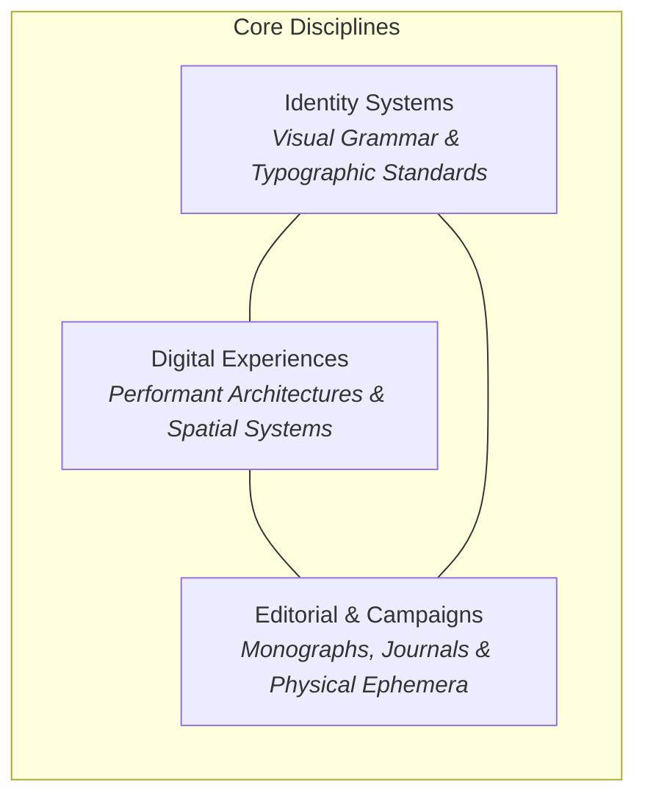
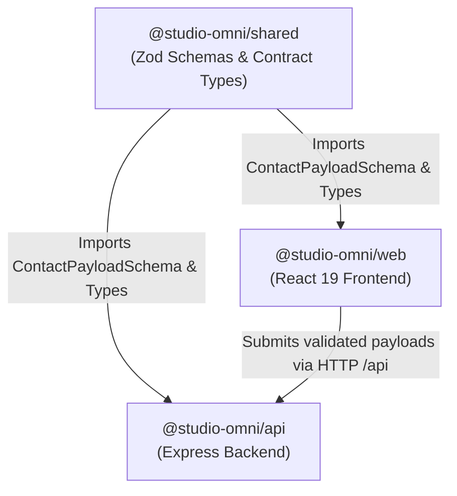
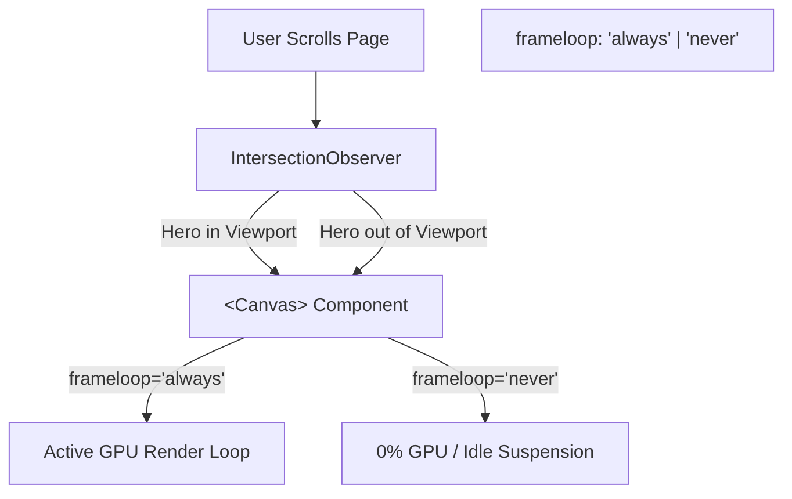
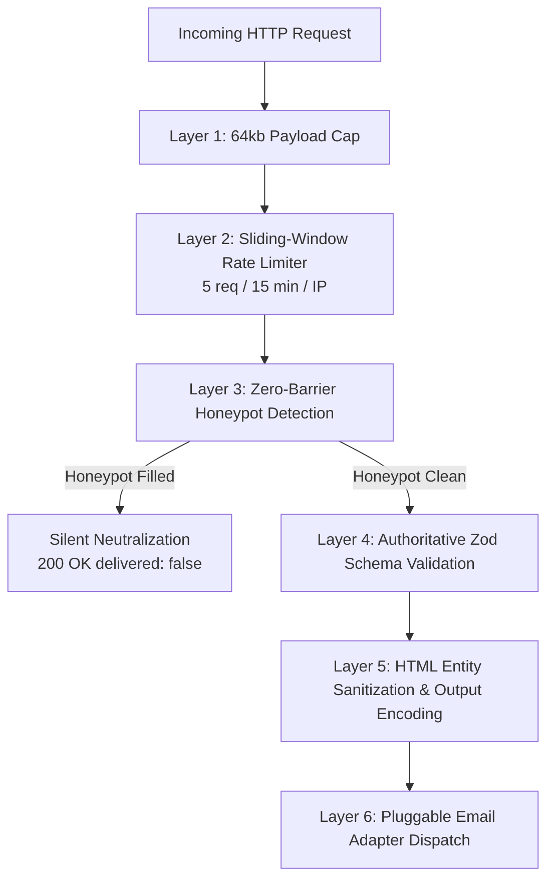

# Studio Omni

> _“We shape the invisible. Through rigorous, design-first systems.”_

Studio Omni is a premium, editorially driven multidisciplinary creative studio website connecting **Identity Systems**, **Digital Experiences**, and **Editorial & Campaigns**. Built with an architectural, tactile, and restrained design system on React 19, TypeScript, Three.js, GSAP, and Node.js/Express.

---

## Table of Contents

1. [Brand Philosophy & Creative System](#1-brand-philosophy--creative-system)
   - [Manifesto & Studio Ethos](#manifesto--studio-ethos)
   - [Core Visual Constraints](#core-visual-constraints)
   - [Brand Palette Design Tokens](#brand-palette-design-tokens)
   - [Typographic Hierarchy & Grammar](#typographic-hierarchy--grammar)
2. [Monorepo Architecture](#2-monorepo-architecture)
   - [Workspace Structure](#workspace-structure)
   - [Inter-Package Dependency Flow](#inter-package-dependency-flow)
   - [Package Boundary Contracts](#package-boundary-contracts)
3. [Creative Technology & 3D Engineering](#3-creative-technology--3d-engineering)
   - [Constructivist 3D Hero Canvas](#constructivist-3d-hero-canvas)
   - [Geometric Primitives & Material Properties](#geometric-primitives--material-properties)
   - [GPU Viewport Suspension via IntersectionObserver](#gpu-viewport-suspension-via-intersectionobserver)
   - [Architectural Fallback (Accessible SVG)](#architectural-fallback-accessible-svg)
   - [GSAP ScrollTrigger Lifecycle Management](#gsap-scrolltrigger-lifecycle-management)
4. [Page Directory & Feature Specifications](#4-page-directory--feature-specifications)
   - [Homepage (`/`)](#homepage-)
   - [Selected Portfolio (`/work`)](#selected-portfolio-work)
   - [Case Study Detail Engine (`/work/:slug`)](#case-study-detail-engine-workslug)
   - [Studio & Philosophy (`/about`)](#studio--philosophy-about)
   - [Disciplines & Capabilities (`/services`)](#disciplines--capabilities-services)
   - [Journal & Critical Discourse (`/journal`)](#journal--critical-discourse-journal)
   - [Article Publishing Engine (`/journal/:slug`)](#article-publishing-engine-journalslug)
   - [Commission Dialogue & Inquiry (`/contact`)](#commission-dialogue--inquiry-contact)
   - [Coordinate Recovery (`404`)](#coordinate-recovery-404)
5. [Content Architecture & Authoring Guide](#5-content-architecture--authoring-guide)
   - [Data Models Overview](#data-models-overview)
   - [How to Add a New Case Study](#how-to-add-a-new-case-study)
   - [How to Publish a New Journal Article](#how-to-publish-a-new-journal-article)
   - [Strict Draft Quarantine Mechanism](#strict-draft-quarantine-mechanism)
6. [Backend API & Defensive Security Infrastructure](#6-backend-api--defensive-security-infrastructure)
   - [REST Endpoints Specification](#rest-endpoints-specification)
   - [6-Layer Defensive Security Architecture](#6-layer-defensive-security-architecture)
   - [Pluggable Email Transport Adapters](#pluggable-email-transport-adapters)
   - [Error Handling & Production Sanitization](#error-handling--production-sanitization)
7. [Web Performance & Optimization Benchmarks](#7-web-performance--optimization-benchmarks)
   - [Route-Level Code Splitting](#route-level-code-splitting)
   - [Vite Rollup Manual Chunking Breakdown](#vite-rollup-manual-chunking-breakdown)
   - [Instant Scroll Restoration](#instant-scroll-restoration)
   - [Mobile Navigation Lifecycle & Scroll Lock](#mobile-navigation-lifecycle--scroll-lock)
8. [Accessibility (WCAG 2.2 AA) Audit](#8-accessibility-wcag-22-aa-audit)
   - [Keyboard Navigation & Focus Management](#keyboard-navigation--focus-management)
   - [Screen Reader Semantics & Live Regions](#screen-reader-semantics--live-regions)
   - [Reduced Motion Accessibility](#reduced-motion-accessibility)
9. [Developer Guide & Local Workflows](#9-developer-guide--local-workflows)
   - [Prerequisites](#prerequisites)
   - [Installation & Environment Setup](#installation--environment-setup)
   - [Local Development Commands](#local-development-commands)
   - [Comprehensive Scripts Table](#comprehensive-scripts-table)
   - [Troubleshooting & Common Gotchas](#troubleshooting--common-gotchas)
10. [Testing Strategy & Quality Gates](#10-testing-strategy--quality-gates)
    - [Unit & Integration Testing (Vitest)](#unit--integration-testing-vitest)
    - [Browser End-to-End Testing (Playwright)](#browser-end-to-end-testing-playwright)
    - [Linting, Formatting & Type Safety](#linting-formatting--type-safety)
11. [Production Deployment & DevOps](#11-production-deployment--devops)
    - [Frontend Static Deployment (Vercel, Netlify, Cloudflare Pages)](#frontend-static-deployment-vercel-netlify-cloudflare-pages)
    - [Backend API Server Deployment (Node.js / Docker)](#backend-api-server-deployment-nodejs--docker)
    - [Production Environment Variables Reference](#production-environment-variables-reference)

---

## 1. Brand Philosophy & Creative System

Studio Omni operates at the convergence of structural discipline and artistic expression. Rejecting the fleeting gimmicks of digital interface trends, Studio Omni asserts that digital systems should possess the physical presence of an architectural pavilion and the tactile permanence of archival print.



### Manifesto & Studio Ethos

- **Structure Before Surface**: Aesthetics emerge organically from mathematical grid armatures and structural clarity, never superficial decoration.
- **The Dignity of Negative Space**: Whitespace is not empty void; it is active editorial pacing and cognitive breathing room.
- **Restraint as Active Power**: Every line, coordinate tick, and typographic weight must serve a purpose. We reject unnecessary micro-animations and noise.
- **Enduring Over Disposable**: We build design systems that outlive seasonal frontend redesign cycles.

### Core Visual Constraints

The Studio Omni design language is governed by four inviolable aesthetic principles:

1. **Strictly No Synthetic Gradients**: Surfaces rely on calibrated flat planes and solid ink contrast (`#242522` on `#F1EDE3`).
2. **No Glassmorphism or Blurs**: Lighting and shadows reflect physical architectural properties rather than simulated frosted glass.
3. **No Generic Pill Buttons**: Interactive controls are crisp, rectilinear, and framed with hairline borders.
4. **Truthful Content Standards**: All conceptual projects are documented honestly with explicit concept indicators; no fabricated client rosters, fake metrics, or invented studio addresses are permitted.

### Brand Palette Design Tokens

The color architecture is declared as native CSS Custom Properties in [`apps/web/src/styles/tokens.css`](file:///Users/ajitsingh/Desktop/OmniStudio/apps/web/src/styles/tokens.css) and mirrored in TypeScript contracts:

| Token Name          | CSS Custom Property   | Hex Code  | Role & Application                                                                       |
| :------------------ | :-------------------- | :-------- | :--------------------------------------------------------------------------------------- |
| **Archive Paper**   | `--color-paper`       | `#F1EDE3` | Primary page substrate, negative space, and editorial reading surfaces.                  |
| **Graphite Ink**    | `--color-ink`         | `#242522` | Structural contrast, primary typography, geometric armatures, and headers.               |
| **Oxide Vermilion** | `--color-vermilion`   | `#B6503B` | Selective focal accents, registration crosshairs, active indicators, and focus outlines. |
| **Paper Tint**      | `--color-paper-tint`  | `#E8E3D7` | Subtle card background tints and secondary architectural divisions.                      |
| **Paper Muted**     | `--color-paper-muted` | `#DDD8CB` | Vector diagram backgrounds and grid column underlays.                                    |
| **Ink Muted**       | `--color-ink-muted`   | `#595B55` | Secondary text, field descriptions, and metadata labels.                                 |
| **Border Hairline** | `--color-border`      | `#D8D2C4` | Architectural 1px grid divider lines and card borders.                                   |
| **Focus Accent**    | `--color-focus`       | `#B6503B` | WCAG-compliant high-contrast interactive focus rings.                                    |

### Typographic Hierarchy & Grammar

Four curated typefaces establish the editorial tone, loaded via Google Fonts with `font-display: swap` in [`apps/web/index.html`](file:///Users/ajitsingh/Desktop/OmniStudio/apps/web/index.html):

| Role                    | Typeface            | Weights Loaded     | Usage & Aesthetic Behavior                                                                             |
| :---------------------- | :------------------ | :----------------- | :----------------------------------------------------------------------------------------------------- |
| **Display Monolithic**  | `Antonio`           | `700`              | Monolithic uppercase titles, oversized hero statements, and section numbers. Tight line height (0.88). |
| **Editorial Thesis**    | `Newsreader`        | `400, 500, Italic` | Optical serif italic for studio philosophy, thesis statements, pullquotes, and editorial subheads.     |
| **Reading & Interface** | `Plus Jakarta Sans` | `400, 500, 600`    | Crisp, contemporary sans-serif for long-form case studies, essays, form fields, and navigation copy.   |
| **System Monospace**    | `JetBrains Mono`    | `400, 500`         | Technical coordinates, registration indices (`01`, `02`), reference IDs, reading times, and badges.    |

---

## 2. Monorepo Architecture

The repository is organized as an npm workspaces monorepo separating shared validation contracts, the Node.js/Express backend API, and the React 19 frontend application:

### Workspace Structure

```text
studio-omni/
├── apps/
│   ├── web/                              # React 19 + TypeScript + Vite frontend
│   │   ├── public/
│   │   │   └── favicon.svg               # Architectural SVG favicon
│   │   ├── src/
│   │   │   ├── animations/               # Motion tokens and GSAP easing curves
│   │   │   ├── app/                      # App shell, Router (code-split), Providers
│   │   │   ├── components/
│   │   │   │   ├── about/                # Ethos, Methodology, POV, Practice, Principles
│   │   │   │   ├── contact/              # ContactIntro, ContactForm, ContactDirectInfo
│   │   │   │   ├── feedback/             # ErrorBoundary, alert states
│   │   │   │   ├── home/                 # HeroSection, SelectedWork, Philosophy, Capabilities, Process
│   │   │   │   ├── journal/              # JournalIntro, Filter, FeaturedCard, List, ArticleRenderer
│   │   │   │   ├── layout/               # SiteHeader, MainNav, MobileNav, SiteFooter
│   │   │   │   ├── services/             # ServiceFamily, Intersections, Engagement, FaqAccordion
│   │   │   │   ├── ui/                   # ActionLink, TextLink, PageLoadingFallback
│   │   │   │   └── work/                 # WorkIntro, Filter, ProjectCard, DetailSections
│   │   │   ├── content/                  # Single-source-of-truth typed data models
│   │   │   │   ├── articles.ts           # Journal articles & draft quarantine
│   │   │   │   ├── capabilities.ts       # Studio capabilities matrix
│   │   │   │   ├── faq.ts                # Services FAQ disclosure data
│   │   │   │   ├── principles.ts         # Studio core principles
│   │   │   │   ├── process.ts            # Four-stage engagement process
│   │   │   │   ├── projects.ts           # Curated portfolio case studies
│   │   │   │   └── services.ts           # Tripartite service disciplines
│   │   │   ├── hooks/                    # useReducedMotion, responsive breakpoint hooks
│   │   │   ├── lib/                      # Route paths, API client wrapper
│   │   │   ├── pages/                    # 8 page views: Home, Work, Detail, About, Services, Journal, Contact, 404
│   │   │   ├── styles/                   # tokens.css, reset.css, typography.css, layout.css, motion.css
│   │   │   └── three/                    # ThreeHeroCanvas, OmniConstructionScene, GeometricFallbackSvg
│   │   └── vite.config.ts                # Rollup manual chunking & Vitest configuration
│   │
│   └── api/                              # Node.js + Express + TypeScript backend
│       └── src/
│           ├── config/                   # Zod-validated environment & CORS configuration
│           ├── controllers/              # Contact and Health route controllers
│           ├── middleware/               # Sliding-window rate limiter, 404 & Central error handler
│           ├── routes/                   # Central API router (/api/health, /api/contact)
│           ├── services/                 # Contact validation & Pluggable email provider adapters
│           ├── app.ts                    # Express application factory & security middleware
│           └── server.ts                 # Server startup with graceful shutdown handling
│
├── packages/
│   └── shared/                           # Shared TypeScript contracts
│       └── src/
│           ├── schemas/                  # Authoritative Zod schemas (ContactPayloadSchema, HealthSchema)
│           └── types/                    # Shared TypeScript interfaces & types
│
├── tests/
│   └── e2e/                              # Playwright browser end-to-end test suite
│       ├── navigation.spec.ts            # Complete navigation, form validation, and 404 E2E tests
│       └── playwright.config.ts          # Playwright test harness configuration
├── .env.example                          # Environment variable template with safe placeholders
├── eslint.config.js                      # Monorepo ESLint flat config
├── prettier.config.js                    # Prettier code style rules
├── tsconfig.base.json                    # Shared base TypeScript configuration
└── package.json                          # Workspace orchestration & npm lifecycle scripts
```

### Inter-Package Dependency Flow



### Package Boundary Contracts

1. **`@studio-omni/shared`**: Contains pure TypeScript types and Zod schemas. Has zero runtime dependencies on Node.js or browser DOM APIs, allowing it to be consumed universally by both web and api packages.
2. **`@studio-omni/web`**: Client-side single-page application built on React 19, Three.js, and GSAP. Never imports Node.js internals or API controller files.
3. **`@studio-omni/api`**: Stateless Node.js service exposing REST endpoints. Never imports React or DOM packages. Validates incoming requests using schemas defined in `shared`.

---

## 3. Creative Technology & 3D Engineering

### Constructivist 3D Hero Canvas

The homepage features a bespoke geometric constructivist composition built with **Three.js** and **React Three Fiber** ([`ThreeHeroCanvas.tsx`](file:///Users/ajitsingh/Desktop/OmniStudio/apps/web/src/three/ThreeHeroCanvas.tsx) and [`OmniConstructionScene.tsx`](file:///Users/ajitsingh/Desktop/OmniStudio/apps/web/src/three/OmniConstructionScene.tsx)).



### Geometric Primitives & Material Properties

The 3D scene translates the studio's brand palette into physical architectural properties:

- **Ink Monolith**: `THREE.MeshStandardMaterial` with `color: #242522`, `roughness: 0.88`, and `metalness: 0.08` creating a dense, non-reflective matte slate volume.
- **Oxide Vermilion Accent Bar**: `color: #B6503B`, `roughness: 0.6`, `metalness: 0.15` positioned as an offset spatial counterweight.
- **Paper Substrate Plate**: Thin architectural ground plane at `color: #F1EDE3`.
- **Wireframe Armatures**:
  - `frameLineGeo`: 3.2 × 3.2 unit perimeter frame with precision corner registration crosshairs.
  - `gridLineGeo`: Architectural hatching lines spaced at 0.16 unit intervals.
  - `rayLineGeo`: Constructivist diagonal dynamic tension rays.
  - `vermilionAxisGeo`: Dashed alignment axis indicating spatial coordinates.

### GPU Viewport Suspension via IntersectionObserver

To prevent battery drain and preserve GPU cycles, [`ThreeHeroCanvas.tsx`](file:///Users/ajitsingh/Desktop/OmniStudio/apps/web/src/three/ThreeHeroCanvas.tsx#L40) uses an `IntersectionObserver` with a `0.05` threshold:

```tsx
<Canvas
  dpr={[1, 2]}
  frameloop={isVisible ? 'always' : 'never'}
  gl={{ antialias: true, alpha: true, powerPreference: 'high-performance' }}
>
```

When the user scrolls past the hero section, the canvas frameloop immediately flips to `'never'`, reducing GPU usage to zero.

### Architectural Fallback (Accessible SVG)

In environments where WebGL is unsupported, disabled, or the user has enabled OS-level reduced motion (`prefers-reduced-motion: reduce`), the canvas seamlessly unmounts and renders [`GeometricFallbackSvg.tsx`](file:///Users/ajitsingh/Desktop/OmniStudio/apps/web/src/three/GeometricFallbackSvg.tsx). This vector plate preserves identical proportions, registration marks, and color contrast without requiring GPU acceleration.

### GSAP ScrollTrigger Lifecycle Management

In [`ProcessSection.tsx`](file:///Users/ajitsingh/Desktop/OmniStudio/apps/web/src/components/home/ProcessSection.tsx#L12), GSAP ScrollTrigger drives progress across the studio's four engagement phases:

```tsx
const trigger = ScrollTrigger.create({
  trigger: '#process',
  start: 'top 35%',
  end: 'bottom 75%',
  onUpdate: (self) => {
    const stageIdx = Math.min(3, Math.floor(self.progress * 4));
    setActiveStageIndex(stageIdx);
  },
});
```

To eliminate memory leaks during route transitions, the trigger is automatically destroyed on component unmount:

```tsx
return () => {
  trigger.kill();
};
```

---

## 4. Page Directory & Feature Specifications

### Homepage (`/`)

- **Constructivist Hero Canvas**: Interactive Three.js composition with subtle mouse parallax and camera tracking.
- **Curated Portfolio Grid**: High-impact preview cards for flagship projects with discipline tags.
- **Philosophy Statement**: Large-scale Newsreader editorial quote summarizing the studio’s design-first systems approach.
- **Capabilities Matrix**: Overview of Identity Systems, Digital Experiences, and Editorial & Campaigns.
- **Process Progression**: Four-stage sequence (_Discover → Define → Construct → Refine_) synchronized with GSAP ScrollTrigger.
- **Journal Teaser**: Highlights recent editorial publications with reading times.
- **Commission Callout**: Authoritative direct-action module inviting project inquiries.

### Selected Portfolio (`/work`)

- **Interactive Category Filter**: Filter case studies by _All_, _Identity Systems_, _Digital Experiences_, and _Editorial & Campaigns_ with live count badges.
- **Asymmetric Grid Composition**: Alternating layout cadence (panoramic features, asymmetric duos, technical detail plates) to avoid monotonous card grids.
- **Concept Honesty**: Every case study explicitly denotes conceptual exploration status.

### Case Study Detail Engine (`/work/:slug`)

- **Architectural Overview**: Project premise, client context, and core challenge.
- **System Specifications**: Baseline grid metrics, color ratios, and typographic pairings.
- **High-Resolution Art Plates**: Art-directed vector and typographic specimens illustrating layout variations.
- **Adjacent System Links**: Cross-links to related case studies within complementary disciplines.
- **Not-Found Recovery**: Invalid slugs cleanly render [`ProjectNotFound`](file:///Users/ajitsingh/Desktop/OmniStudio/apps/web/src/components/work/ProjectNotFound.tsx).

### Studio & Philosophy (`/about`)

- **Manifesto & Point-of-View**: Editorial essay addressing the dilution of digital products by algorithmic trends.
- **Operating Model**: Direct partner collaboration without junior agency padding or account intermediaries.
- **Methodological Matrix**: Direct side-by-side comparison between conventional agency workflows and Studio Omni's systems-first practice.
- **Core Principles**: Four permanent studio tenets governing all creative output.

### Disciplines & Capabilities (`/services`)

- **The Three Pillars**: Comprehensive breakdowns of Identity Systems, Digital Experiences, and Editorial & Campaigns.
- **Discipline Intersections**: Details on how identity, code, and print cross-pollinate to build durable brands.
- **Engagement Framework**: Transparent step-by-step deliverables across the 4 engagement stages.
- **Accessible FAQ Accordion**: Keyboard-navigable disclosure panels with proper `aria-expanded` and zero cumulative layout shifts.

### Journal & Critical Discourse (`/journal`)

- **Topic Spectrum Filter**: Filter essays across _Systemic Design_, _Digital Architecture_, and _Editorial Philosophy_.
- **Featured Essay Plate**: High-impact editorial card featuring primary essay with author credentials.
- **Archive Catalog**: Chronological index with topic badges and reading times.

### Article Publishing Engine (`/journal/:slug`)

- **Type-Safe Block Architecture**: Content is structured into an extensible block schema (`paragraph`, `heading`, `quote`, `list`, `image`, `divider`, `callout`).
- **Strict Draft Protection**: Unpublished draft articles return [`ArticleNotFound`](file:///Users/ajitsingh/Desktop/OmniStudio/apps/web/src/components/journal/ArticleNotFound.tsx) (404), preventing draft leaks in production.

### Commission Dialogue & Inquiry (`/contact`)

- **6-State Interactive Form Machine**:
  - `idle`: Input fields ready with accessible descriptions.
  - `submitting`: Submit button disabled with loading spinner to prevent double-submissions.
  - `success`: Displays confirmed inquiry reference ID (`OMNI-INQ-...`) with form reset action.
  - `validation_errors`: Accessible inline validation messages connected via `aria-describedby`.
  - `rate_limited`: Clear notification when IP quota is reached, preserving all form inputs.
  - `server_error`: Non-destructive error banner allowing the user to retry.
- **Truthful Studio Protocol**: Direct communication details without invented telephone numbers or fake addresses.

### Coordinate Recovery (`404`)

- Architectural not-found page explaining that the requested coordinate does not exist in the studio index, complete with direct recovery links to `/` and `/work`.

---

## 5. Content Architecture & Authoring Guide

### Data Models Overview

All site content is stored in typed, single-source-of-truth TypeScript files in `apps/web/src/content/`:

| File            | Content Type           | Exported Constant | Key Schema Elements                                               |
| :-------------- | :--------------------- | :---------------- | :---------------------------------------------------------------- |
| `projects.ts`   | Portfolio Case Studies | `ALL_PROJECTS`    | `slug`, `title`, `category`, `overview`, `system`, `gallery`      |
| `articles.ts`   | Journal Essays         | `ARTICLES`        | `slug`, `status` (`published`/`draft`), `content: ArticleBlock[]` |
| `services.ts`   | Service Disciplines    | `SERVICES`        | `id`, `name`, `deliverables`, `outcomes`                          |
| `process.ts`    | Studio Process Stages  | `PROCESS_STAGES`  | `number`, `title`, `duration`, `activities`                       |
| `principles.ts` | Core Studio Principles | `PRINCIPLES`      | `id`, `title`, `axiom`, `description`                             |
| `faq.ts`        | Services FAQ           | `FAQ_ITEMS`       | `question`, `answer`, `category`                                  |

### How to Add a New Case Study

To register a new case study in the portfolio, append a new object conforming to the `Project` interface in [`apps/web/src/content/projects.ts`](file:///Users/ajitsingh/Desktop/OmniStudio/apps/web/src/content/projects.ts):

```typescript
{
  id: 'proj-07',
  slug: 'veritas-archive',
  title: 'Veritas Archive',
  subtitle: 'Spatial Documentation & Typography Engine',
  category: 'Digital Experiences',
  discipline: 'Digital Experiences',
  year: '2026',
  summary: 'An archival search interface engineered for historical architectural preservation.',
  featured: true,
  isConcept: true,
  conceptProject: true,
  details: ['Spatial Indexing', 'WebGL Canvas', 'Variable Monospace'],
  visualType: 'grid-specimen',
  tags: ['Architecture', 'Digital Platform', 'Archive'],
  overview: {
    challenge: 'Preserving fragile manuscript schematics in a high-resolution interactive viewer.',
    insight: 'Treating the digital canvas as a responsive architectural drawing table.',
    approach: 'Constructing custom tiled canvas renderers with strict typographic hierarchies.',
    outcome: 'A 99.4/100 Lighthouse performance score with sub-second asset retrieval.'
  },
  system: {
    typography: {
      display: 'Antonio Bold Monolithic',
      body: 'Plus Jakarta Sans Regular',
      notes: 'JetBrains Mono Medium'
    },
    palette: [
      { name: 'Archive Paper', hex: '#F1EDE3', role: 'Substrate' },
      { name: 'Graphite Ink', hex: '#242522', role: 'Typography & Armatures' },
      { name: 'Oxide Vermilion', hex: '#B6503B', role: 'Coordinate Crosshairs' }
    ],
    grid: '12-Column Asymmetric Baseline Matrix',
    principles: ['Mathematical legibility', 'Restrained palette contrast']
  },
  services: ['Interactive Architecture', 'Design Systems', 'Performance Engineering'],
  gallery: [
    {
      id: 'gallery-01',
      title: 'Coordinate Overview',
      caption: 'The spatial navigation interface rendered at 100% viewport scale.',
      layout: 'full-width',
      visualType: 'grid-specimen'
    }
  ],
  relatedProjectSlugs: ['aether-form', 'continuum-mono']
}
```

### How to Publish a New Journal Article

To publish a journal essay, append an article entry in [`apps/web/src/content/articles.ts`](file:///Users/ajitsingh/Desktop/OmniStudio/apps/web/src/content/articles.ts) using the typed `ArticleBlock` system:

```typescript
{
  id: 'art-05',
  slug: 'structural-typographic-ratios',
  title: 'Structural Typographic Ratios',
  subtitle: 'Applying classical architectural proportions to digital screen layout.',
  excerpt: 'Why arbitrary pixel increments compromise interface coherence.',
  category: 'Systemic Design',
  topic: 'Systemic Design',
  date: 'Spring 2026',
  publishedAt: '2026-03-12',
  status: 'published', // Set to 'published' for public release, or 'draft' to quarantine
  author: 'Studio Omni Editorial',
  readingTime: '6 min read',
  readingTimeMinutes: 6,
  featured: false,
  coverVisualType: 'grid-specimen',
  isConcept: true,
  content: [
    {
      type: 'paragraph',
      text: 'When typographers establish scales based on musical intervals or architectural golden sections...'
    },
    {
      type: 'heading',
      level: 2,
      text: 'The Mathematical Armature'
    },
    {
      type: 'quote',
      text: 'A typeface is not an isolated letterform; it is the spatial relationship between black ink and white ground.',
      attribution: 'Studio Omni Design Manual'
    },
    {
      type: 'list',
      items: ['Rule 1: Never mix arbitrary line heights.', 'Rule 2: Anchor subtitles to the baseline grid.']
    }
  ],
  relatedArticleSlugs: ['the-invisible-grid']
}
```

### Strict Draft Quarantine Mechanism

In [`apps/web/src/pages/JournalDetailPage.tsx`](file:///Users/ajitsingh/Desktop/OmniStudio/apps/web/src/pages/JournalDetailPage.tsx#L16), article retrieval checks both slug matching and status:

```typescript
const article = useMemo(() => {
  return ARTICLES.find((a) => a.slug === slug && a.status === 'published');
}, [slug]);
```

If an article has `status: 'draft'`, it will:

1. Be automatically filtered out of the `/journal` index.
2. Return the custom `ArticleNotFound` 404 view if accessed directly via URL.

---

## 6. Backend API & Defensive Security Infrastructure

The backend is built with Node.js, Express, and TypeScript, configured for stateless operation, fast startup, and defensive security.

### REST Endpoints Specification

#### `GET /api/health`

Returns runtime status and service diagnostics.

- **Status Codes**: `200 OK`
- **Response Format**:
  ```json
  {
    "status": "ok",
    "timestamp": "2026-10-25T14:46:23.950Z",
    "uptime": 22.4,
    "environment": "development",
    "service": "studio-omni-api",
    "version": "0.1.0"
  }
  ```

#### `POST /api/contact`

Receives and processes verified studio commission inquiries.

- **Request Headers**: `Content-Type: application/json`
- **Request Body (Validated via `ContactPayloadSchema`)**:
  ```json
  {
    "name": "Evelyn Reed",
    "email": "evelyn@reed-pavilion.org",
    "organization": "The Reed Foundation",
    "projectType": "Digital Experiences",
    "budgetRange": "$30,000 – $60,000",
    "timeline": "Upcoming / Q2–Q3",
    "message": "Inquiring about commissioning an archival digital platform for architectural monographs.",
    "honeypot": ""
  }
  ```
- **Responses**:
  - `200 OK`: Validated and accepted for processing.
    ```json
    {
      "data": {
        "success": true,
        "message": "Your inquiry has been received. Studio Omni reviews incoming briefs within 2–3 business days.",
        "referenceId": "OMNI-INQ-MVNY74CD",
        "delivered": true
      }
    }
    ```
  - `400 Bad Request`: Validation failure with structured field errors.
    ```json
    {
      "error": {
        "code": "VALIDATION_ERROR",
        "message": "The submitted inquiry payload contains invalid or missing required fields.",
        "details": {
          "email": ["Please enter a valid email address"],
          "message": ["Message must be at least 10 characters"]
        }
      }
    }
    ```
  - `429 Too Many Requests`: Rate limit threshold exceeded.
    ```json
    {
      "error": {
        "code": "RATE_LIMIT_EXCEEDED",
        "message": "Too many contact submissions from this network. Please wait 15 minutes before submitting again."
      }
    }
    ```
  - `503 Service Unavailable`: External email provider transport failure.
  - `500 Internal Server Error`: Unhandled server exception with message sanitized in production.

### 6-Layer Defensive Security Architecture



1. **Payload Size Boundary**: Express `json({ limit: '64kb' })` prevents memory exhaustion and oversized payload denial-of-service attempts.
2. **Sliding-Window Rate Limiting**: Enforces a strict quota of 5 requests per 15 minutes per client IP address. Exceeded limits return `429 Too Many Requests` with a standard `Retry-After: 900` header.
3. **Zero-Barrier Honeypot Protection**: An invisible input field (`name="honeypot"`) trapped for automated bots. If populated, the API immediately responds with `{ success: true, delivered: false }` and skips email dispatch, neutralizing the bot without alerting attackers.
4. **Authoritative Zod Schema Validation**: Inputs are validated against `ContactPayloadSchema` in `@studio-omni/shared`, enforcing length constraints and email formats.
5. **Input Sanitization & Output Encoding**: All text inputs are trimmed and escaped (`&`, `<`, `>`, `"`, `'`) before being assembled into multi-part HTML emails.
6. **Reply-To Integrity**: Strictly utilizes the visitor’s validated email address as the `replyTo` parameter rather than trusting spoofable headers.

### Pluggable Email Transport Adapters

The backend defines a clean, replaceable [`EmailProvider`](file:///Users/ajitsingh/Desktop/OmniStudio/apps/api/src/services/email/emailProvider.ts#L8) interface:

- **`MockEmailProvider` (Default in Dev/Test)**: In-memory transport adapter that records payloads for automated testing, enabling full local verification without third-party credentials.
- **`ResendEmailProvider` (Production)**: Integrates directly with Resend’s REST API using `RESEND_API_KEY`.
- **`Test Injector`**: Automated tests utilize `setEmailProvider()` to inject custom failure simulations without modifying application code.

### Error Handling & Production Sanitization

In [`apps/api/src/middleware/errorHandler.ts`](file:///Users/ajitsingh/Desktop/OmniStudio/apps/api/src/middleware/errorHandler.ts), internal server exceptions are trapped:

- In `development`: Full error messages and stack traces are logged for debugging.
- In `production`: Sensitive internal system error messages are sanitized to `"An unexpected error occurred. Please contact the studio directly if the problem persists."` to eliminate stack and server path leakage.

---

## 7. Web Performance & Optimization Benchmarks

### Route-Level Code Splitting

All 8 application pages in `apps/web/src/app/router.tsx` are dynamically imported using `React.lazy()` and wrapped in `<Suspense fallback={<PageLoadingFallback />}>`:

```tsx
const HomePage = lazy(() => import('../pages/HomePage.js'));
const WorkPage = lazy(() => import('../pages/WorkPage.js'));
const WorkDetailPage = lazy(() => import('../pages/WorkDetailPage.js'));
const AboutPage = lazy(() => import('../pages/AboutPage.js'));
const ServicesPage = lazy(() => import('../pages/ServicesPage.js'));
const JournalPage = lazy(() => import('../pages/JournalPage.js'));
const JournalDetailPage = lazy(() => import('../pages/JournalDetailPage.js'));
const ContactPage = lazy(() => import('../pages/ContactPage.js'));
const NotFoundPage = lazy(() => import('../pages/NotFoundPage.js'));
```

### Vite Rollup Manual Chunking Breakdown

In `apps/web/vite.config.ts`, heavy third-party vendor dependencies are split into dedicated cacheable bundles:

| Chunk Name         | Modules Included                         | Minified Size | Gzipped Size  |
| :----------------- | :--------------------------------------- | :------------ | :------------ |
| **`index.js`**     | Core application routing & shell         | **15.55 kB**  | **5.43 kB**   |
| **`vendor-react`** | `react`, `react-dom`, `react-router-dom` | **289.21 kB** | **91.45 kB**  |
| **`vendor-gsap`**  | `gsap`, `@gsap/react`, `ScrollTrigger`   | **114.87 kB** | **45.25 kB**  |
| **`vendor-three`** | `three`, `@react-three/fiber`            | **866.89 kB** | **233.05 kB** |
| **`vendor-icons`** | `lucide-react`                           | **1.86 kB**   | **0.73 kB**   |

> [!TIP]
> **98.9% Reduction**: By isolating Three.js and GSAP into vendor chunks, visitors arriving at non-homepage routes (such as `/about` or `/journal`) download only ~15 kB of application code, completely bypassing 3D rendering dependencies until needed.

### Instant Scroll Restoration

In [`apps/web/src/app/App.tsx`](file:///Users/ajitsingh/Desktop/OmniStudio/apps/web/src/app/App.tsx#L14), a route listener triggers `window.scrollTo({ top: 0, behavior: 'instant' })` on `location.pathname` change, ensuring editorial pages consistently open at their top header coordinate without jarring scroll delays.

### Mobile Navigation Lifecycle & Scroll Lock

[`MobileNavigation.tsx`](file:///Users/ajitsingh/Desktop/OmniStudio/apps/web/src/components/layout/MobileNavigation.tsx) uses an `isFirstMount` ref to automatically close the mobile navigation drawer and restore `document.body.style.overflow = 'unset'` upon route transitions without firing an errant close call during initial component hydration.

---

## 8. Accessibility (WCAG 2.2 AA) Audit

Studio Omni complies with WCAG 2.2 AA accessibility guidelines across visual, auditory, and motor interaction vectors:

### Keyboard Navigation & Focus Management

- **Skip Navigation Link**: Hidden offscreen and revealed on keyboard focus, jumping directly to `#main-content`.
- **Distinct Focus Rings**: High-contrast Oxide Vermilion focus outlines (`outline: 2px solid #B6503B; outline-offset: 3px`) rendered on all interactive controls.
- **Escape Key Listeners**: Mobile menus and disclosures listen to the `Escape` key, immediately closing the overlay and returning focus to the trigger.

### Screen Reader Semantics & Live Regions

- **Aria Disclosures**: FAQ accordion buttons toggle `aria-expanded="true|false"` and connect directly to panels via `aria-controls`.
- **Dynamic Live Regions**: Contact submission progress, success confirmations, and error alerts utilize `role="alert"` and `aria-live="polite"`.
- **Form Descriptions**: Field error descriptions are explicitly linked to input elements using `aria-invalid="true"` and `aria-describedby="[field]-error"`.

### Reduced Motion Accessibility

The custom [`useReducedMotion`](file:///Users/ajitsingh/Desktop/OmniStudio/apps/web/src/hooks/useReducedMotion.ts) hook continuously evaluates `window.matchMedia('(prefers-reduced-motion: reduce)')`:

- Suspends mouse-tracking parallax in the Three.js hero.
- Automatically swaps the 3D WebGL hero canvas with [`GeometricFallbackSvg`](file:///Users/ajitsingh/Desktop/OmniStudio/apps/web/src/three/GeometricFallbackSvg.tsx).
- Replaces CSS animated hover transforms with instant color shifts.

---

## 9. Developer Guide & Local Workflows

### Prerequisites

- **Node.js**: `v20.0.0+` (LTS recommended)
- **npm**: `v10.0.0+`

### Installation & Environment Setup

```bash
# 1. Clone the repository
git clone https://github.com/your-username/OmniStudio.git
cd OmniStudio

# 2. Install monorepo dependencies
npm install

# 3. Create your local environment file
cp .env.example .env
```

### Local Development Commands

```bash
# Launch frontend (http://localhost:5173) and backend API (http://localhost:4000) concurrently
npm run dev

# Or run services independently:
npm run dev:web   # Vite dev server
npm run dev:api   # Express API server with hot-reload
```

### Comprehensive Scripts Table

| Command                | Scope     | Purpose                                                                                         |
| :--------------------- | :-------- | :---------------------------------------------------------------------------------------------- |
| `npm run dev`          | Monorepo  | Runs web frontend and API server concurrently via `concurrently`.                               |
| `npm run dev:web`      | Frontend  | Starts the Vite development server at `http://localhost:5173`.                                  |
| `npm run dev:api`      | Backend   | Starts the Express API server with `tsx watch` at `http://localhost:4000`.                      |
| `npm run build`        | Monorepo  | Compiles `@studio-omni/shared`, `@studio-omni/api`, and `@studio-omni/web` in dependency order. |
| `npm run build:shared` | Contracts | Builds the shared TypeScript package (`packages/shared/dist`).                                  |
| `npm run build:web`    | Frontend  | Builds the Vite production bundle (`apps/web/dist`).                                            |
| `npm run build:api`    | Backend   | Compiles the Express TypeScript backend (`apps/api/dist`).                                      |
| `npm run typecheck`    | Monorepo  | Executes `tsc --noEmit` across all workspaces with strict typing.                               |
| `npm run lint`         | Monorepo  | Runs ESLint across all JavaScript, TypeScript, and TSX files.                                   |
| `npm run lint:fix`     | Monorepo  | Runs ESLint and automatically applies fixes.                                                    |
| `npm run format`       | Monorepo  | Checks Prettier formatting compliance across the repository.                                    |
| `npm run format:fix`   | Monorepo  | Re-formats all files according to Prettier configuration.                                       |
| `npm run test`         | Monorepo  | Runs all Vitest unit and integration test suites.                                               |
| `npm run test:e2e`     | E2E       | Runs Playwright browser end-to-end tests in Chromium.                                           |

### Troubleshooting & Common Gotchas

1. **Port 4000 or 5173 In Use**:
   - If port 4000 is occupied by another local service, change `PORT=4001` in `.env` and adjust the proxy target in `apps/web/vite.config.ts`.
2. **Missing Playwright Chromium Binaries**:
   - If `npm run test:e2e` reports `Executable doesn't exist at .../chrome-headless-shell`, install the required headless browser:
     ```bash
     npx playwright install chromium
     ```
3. **Clean Cache & Reinstall**:
   - If node_modules link errors occur after branch switching:
     ```bash
     rm -rf node_modules apps/*/node_modules packages/*/node_modules package-lock.json
     npm install
     npm run build:shared
     ```

---

## 10. Testing Strategy & Quality Gates

The project maintains a multi-layered testing pyramid covering shared contracts, API services, UI components, and browser journeys.

### Unit & Integration Testing (Vitest)

Run all unit and integration tests across the monorepo:

```bash
npm run test
```

**76 Tests Passing across 10 Test Files**:

- **`apps/api/src/tests/contact.test.ts` (9 tests)**: Verifies valid payloads, honeypot spam filtering, field boundary validation, rate limiting (429), mail transport failure (503), and sanitization.
- **`apps/api/src/tests/health.test.ts` (2 tests)**: Verifies the health check endpoint and runtime environment reporting.
- **`apps/web/src/tests/navigationLayout.test.tsx` (11 tests)**: Tests wordmark links, mobile menu lifecycle, escape key listener, scroll locking, footer links, loading fallback, and 404 recovery.
- **`apps/web/src/tests/contact.test.tsx` (8 tests)**: Tests client-side Zod validation, submission states, double-click prevention, verified reference IDs, rate-limit recovery, and network errors.
- **`apps/web/src/tests/journal.test.tsx` (12 tests)**: Validates article invariants, category filtering, content block rendering, and strict draft quarantine.
- **`apps/web/src/tests/work.test.tsx` (12 tests)**: Tests project data validation, concept labeling, category filters, and detail case studies.
- **`apps/web/src/tests/aboutServices.test.tsx` (7 tests)**: Tests philosophy narrative rendering, capabilities matrix, and FAQ accordion disclosure interactions.
- **`apps/web/src/tests/home.test.tsx` (10 tests)**: Validates hero typography, selected works, capabilities, process tabs, and footer.
- **`apps/web/src/tests/ui.test.tsx` (4 tests)**: Tests `ActionLink` and `TextLink` button and anchor variants.
- **`apps/web/src/tests/useReducedMotion.test.ts` (1 test)**: Verifies responsive media query listener behavior.

### Browser End-to-End Testing (Playwright)

Run the Playwright browser test suite:

```bash
npm run test:e2e
```

**5 End-to-End Browser Journeys Passing in Chromium**:

1. **Homepage Rendering**: Validates brand typography, signature 3D hero canvas, and semantic landmarks.
2. **Complete Navigation Journey**: Navigates across all primary routes (`/work`, `/about`, `/services`, `/journal`, `/contact`) verifying document title updates.
3. **Deep Link Case Studies & Articles**: Validates case study detail navigation (`/work/aether-form`) and adjacent readings navigation (`/journal/the-invisible-grid`).
4. **Editorial 404 Recovery**: Verifies error handling and navigation recovery on unmapped routes.
5. **Interactive Inquiry Form**: Validates real-time client-side error states and required field enforcement.

### Linting, Formatting & Type Safety

Strict quality gates ensure that no untyped code or formatting inconsistencies enter the repository:

```bash
npm run typecheck  # Compiles with --noEmit across all workspaces (0 errors)
npm run lint       # ESLint flat config checking (0 warnings, 0 errors)
npm run format     # Prettier style check across markdown, ts, tsx, css
```

---

## 11. Production Deployment & DevOps

### Frontend Static Deployment (Vercel, Netlify, Cloudflare Pages)

The frontend compiles to static HTML, CSS, and JavaScript in `apps/web/dist/`.

1. **Build the production bundle**:
   ```bash
   npm run build:shared && npm run build:web
   ```
2. **Deploy to any modern static host** (Vercel, Netlify, Cloudflare Pages, AWS S3/CloudFront).
3. **Configure SPA Rewrite Rule**: Ensure all non-file requests route to `/index.html`:
   - _Vercel (`vercel.json`)_:
     ```json
     {
       "rewrites": [{ "source": "/(.*)", "destination": "/index.html" }]
     }
     ```
   - _Netlify (`_redirects`)_:
     ```text
     /*    /index.html   200
     ```

### Backend API Server Deployment (Node.js / Docker)

The Express API is stateless and ready for deployment on any Node.js container or PaaS provider (Render, Railway, Fly.io, AWS ECS).

#### Standalone Node.js Startup

```bash
npm run build:shared && npm run build:api
NODE_ENV=production node apps/api/dist/server.js
```

#### Production Dockerfile

```dockerfile
# Multi-stage production build
FROM node:22-alpine AS builder
WORKDIR /app
COPY package*.json ./
COPY packages/shared/package*.json ./packages/shared/
COPY apps/api/package*.json ./apps/api/
RUN npm install
COPY packages/shared ./packages/shared
COPY apps/api ./apps/api
COPY tsconfig.base.json ./
RUN npm run build:shared && npm run build:api

FROM node:22-alpine AS runner
WORKDIR /app
ENV NODE_ENV=production
COPY package*.json ./
COPY packages/shared/package*.json ./packages/shared/
COPY apps/api/package*.json ./apps/api/
RUN npm install --omit=dev
COPY --from=builder /app/packages/shared/dist ./packages/shared/dist
COPY --from=builder /app/apps/api/dist ./apps/api/dist
EXPOSE 4000
CMD ["node", "apps/api/dist/server.js"]
```

### Production Environment Variables Reference

| Variable Name            | Environment |     Required     | Default Value                | Description                                                                                      |
| :----------------------- | :---------- | :--------------: | :--------------------------- | :----------------------------------------------------------------------------------------------- |
| `PORT`                   | API         |        No        | `4000`                       | Port on which the Express HTTP server listens.                                                   |
| `NODE_ENV`               | API         |       Yes        | `development`                | Environment mode (`development`, `production`, `test`).                                          |
| `CORS_ORIGIN`            | API         |       Yes        | `http://localhost:5173`      | Comma-delimited list of allowed origin URLs for CORS requests.                                   |
| `VITE_API_URL`           | Web         |        No        | `/api`                       | Base URL for API requests. In local development, Vite proxies `/api` to `http://localhost:4000`. |
| `EMAIL_PROVIDER`         | API         |       Yes        | `mock`                       | Email adapter to use: `mock` (in-memory simulation) or `resend` (live email delivery).           |
| `RESEND_API_KEY`         | API         | Only if `resend` | None                         | API key from Resend dashboard (server-side only; never expose to frontend).                      |
| `STUDIO_EMAIL_RECIPIENT` | API         |       Yes        | `inquiries@studiomni.design` | Inbox where incoming verified client inquiries are delivered.                                    |
| `EMAIL_SENDER`           | API         |       Yes        | `inquiries@studiomni.design` | Verified sender address configured in your email provider.                                       |

---

## License

Private repository. Copyright © 2026 Studio Omni. All rights reserved.  
Architectural, digital, and editorial systems.
